# SpreMachineScope

Spresense FFT Analyzer sample をもとにしたアプリケーションです。 / Based on the Spresense FFT Analyzer sample.

[日本語](#取扱説明書) | [English](#user-manual) 


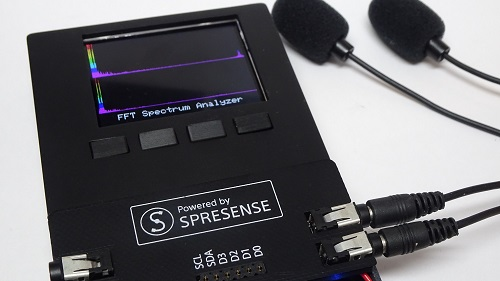

振動センサーを接続するためのアタッチメントをつけることもできます。その他、ピエゾのセンサーを接続することもできます。詳細を知りたい方はご連絡ください。

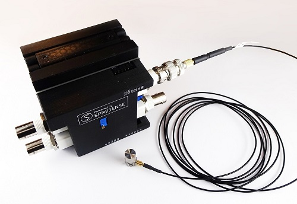

<br/><br/>

# 取扱説明書

**SpreMachineScope** は、Spresense のマイク入力（最大 4 チャンネル）の信号を、LCD 上で波形・スペクトル・スペクトログラム・リサージュ図形として表示する計測アプリケーションです。SD カードへの WAV 録音、録音したファイルの再生解析、画面キャプチャ、測定データの CSV 保存もできます。

<br/><br/>
---

## 1. 準備

### 1-1. 必要なもの
- Spresense メインボード + 拡張ボード
- ILI9341 LCD（320×240）と操作ボタン 4 個（D7 / D6 / D5 / D4）
- マイクまたはセンサ（マイク入力の電圧範囲は ±0.45 V）
- microSD カード（設定ファイル、録音、CSV、キャプチャの保存先）
- ヘッドホン（FILE + SOUND で再生音を聞く場合）

<br/>

### 1-2. かんたんインストール（Releases）
Arduino IDE でビルドしなくても、[Releases](https://github.com/TE-YoshinoriOota/Spresense_fftanalyzer_sample/releases) の zip で書き込めます。

1. Windows は `SpreMachineScope-<版>-windows.zip`、Linux は `SpreMachineScope-<版>-linux.zip` をダウンロードして展開します。
2. Spresense を USB でつなぎ、SD カードをパソコンに挿します。
3. Windows は `install.bat`、Linux は `install.sh` を実行し、シリアルポートと SD カードの場所を入力します。ファームウェアの書き込みと、設定ファイルの SD カードへのコピーを行います。

初回だけ、ブートローダ v3.4.3 の書き込み（Arduino IDE の「ブートローダを書き込む」）が必要です。USB ドライバ、DSP（SRC）など、詳しくは zip の `README.txt` を見てください。

<br/>

### 1-3. ソースからの書き込み手順
1. **DSP コーデックのインストール**: Arduino IDE で「スケッチ例」>「Audio」>「dsp_installer」>「src_installer」を開いて書き込み、シリアルモニタで SD カードを選んでインストールします。
2. **ライブラリ**: [ArduinoJson（作者フォーク版）](https://github.com/TE-YoshinoriOota/ArduinoJson) と、 Spresense 向けに高速化された [Adafruit_ILI9341](https://github.com/kzhioki/Adafruit_ILI9341) と [Adafruit-GFX-Library](https://github.com/kzhioki/Adafruit-GFX-Library)（いずれも `spresense` ブランチ）を Arduino の libraries フォルダに置きます。
3. **設定ファイルのコピー**: `Documents/config`  SD カードにまるごとコピーします。システム設定値や画面の設定値用のファイルです。
4. **Subcore1 の書き込み**: `Subcore1/Subcore1.ino` を開き、「Core」を **SubCore 1** にして書き込みます。
5. **Maincore の書き込み**: `Maincore/Maincore.ino` を開き、「Core」を **MainCore**、「Memory」を **896 kB** にして書き込みます。デフォルト (768 kB) のままだとメモリ不足で動きません。

<br/><br/>
<hr/>


## 2. 基本操作

### 2-1. ボタン
画面下部の 4 つのボタンラベルが、そのときの機能を表します。


| ボタン | ピン | メニュー・設定画面 | グラフ画面 |
|---|---|---|---|
| B0（左） | D7 | DOWN：カーソルを下へ／値を小さく | (−)：表示倍率（AMP）を下げる |
| B1 | D6 | UP：カーソルを上へ／値を大きく | (+)：表示倍率（AMP）を上げる |
| B2 | D5 | BACK：前の画面へ戻る | BACK：前の画面へ戻る |
| B3（右） | D4 | NEXT：決定して次の画面へ | NEXT：次の画面へ |

<br/>
ボタンの同時押しには、次の 2 つの機能があります。
<br/>

| 同時押し | 使える画面 | 機能 |
|---|---|---|
| (−) と (+) | グラフ画面（REC MONITOR を除く） | 表示中のデータを CSV に保存（2-2） |
| BACK と NEXT | すべての画面 | 画面キャプチャ（2-3） |

<br/>
同時押しのときは、それぞれのボタン単独の機能（表示倍率の変更、画面の移動）は働きません。

<br/>

### 2-2. データの保存（CSV）
グラフ画面で (−) と (+) を同時に押すと、表示中のデータを SD カードの `CSVDATA` フォルダに CSV ファイルとして保存します。

- **ファイルの作られ方**: CSV ファイルは、その画面で最初に保存したときに作られます。同じ画面で続けて保存すると、同じファイルに 1 行ずつ追記されます。画面を移ってから保存すると、新しいファイルになります。保存しなかった画面では、ファイルは作られません。
- **保存の確認**: 保存すると、グラフの右上に `SAVED wf01003.csv #2` のように、ファイル名とその画面での保存回数が 3 秒間表示されます（LISSAJOUS MONITOR ではグラフの右側）。保存できなかったときは、赤で `SAVE ERROR` と表示されます。
- **保存できないとき**: 録音中と REC MONITOR 画面では保存しません。

ファイル名は「種類 + 日付 2 桁 + 連番 3 桁」です（例: `wf01003.csv`）。日付は Spresense の時計の日で、時計を合わせていないときは `01` になります。同じ名前のファイルがすでにあるときは、その番号を飛ばして空いている番号を使うので、以前のファイルが上書きされることはありません。

1 回の保存で、画面に応じて次の 1 〜 2 個のファイルに 1 行ずつ書き込みます。
<br/>

| 画面 | ファイル 1 | ファイル 2 |
|---|---|---|
| FFT REALTIME MONITOR、SPECTROGRAM MONITOR | `wf`：波形 | `ft`：スペクトル |
| D-FILTER MONITOR | `wi`：フィルタ前の波形 | `wo`：フィルタ後の波形 |
| DUAL SIGNAL MONITOR、LISSAJOUS MONITOR | `wa`：CH1 の波形 | `wb`：CH2 の波形 |
| FFT DUAL MONITOR | `fa`：CH1 のスペクトル | `fb`：CH2 のスペクトル |

<br/>
各行の先頭の値は、波形ではサンプリング間隔 dt [ms]、スペクトルでは周波数間隔 df [Hz] です。そのあとにデータの値がカンマ区切りで続きます。

<br/><br/>

### 2-3. 画面キャプチャ
BACK と NEXT を同時に押すと、表示中の画面を SD カードの `CAPIMAGE` フォルダに `SCRnnnnn.BMP`（320×240、16 ビットカラー）として保存します。グラフ画面では、キャプチャした瞬間のデータも 2-2 と同じ CSV ファイルに 1 行保存します（このときは `SAVED` は表示されません）。録音中はキャプチャできません。

<br/><br/>

### 2-4. 設定の保存
各画面で選んだ値（チャンネル、ライン数、フィルタ、AMP など）は SD カードの `config/sys.txt` と各画面のファイルに書き込まれ、次回の起動時にも引き継がれます。書き込みは一時ファイルを経由するので、書き込み中に電源が切れても設定ファイルが壊れにくくなっています。

<br/><br/>
<hr/>


## 3. メニュー構成

起動するとホームメニュー「SPRE MACHINE SCOPE」が表示されます。

```
SPRE MACHINE SCOPE
├─ CHANNEL SETUP
│    └─ サンプリングレート選択
│　       └─ 入力チャンネル数選択
│　           └─ FFT 窓関数選択
├─ SINGLE FFT MONITOR … 
│    └─ チャンネル選択 
│　　     └─ ライン数選択 
│　　　       └─ LPF設定 
│　    　　       └─ HPF設定 
│        　　　       └─ D-FILTER MONITOR
│        　　　           └─ FFT 表示レンジ設定
│        　　　               └─ グラフ種類選択
│        　　　                   └─ FFT REALTIME MONITOR
├─ DUAL FFT MONITOR 
│    └─ チャンネル選択 
│　　     └─ ライン数選択 
│　　　       └─ LPF設定 
│　    　　       └─ HPF設定 
│        　　　       └─ DUAL SIGNAL MONITOR
│        　　　           └─ FFT 表示レンジ設定
│        　　　               └─ グラフ種類選択
│        　　　                   └─ FFT DUAL MONITOR / LISSAJOUS MONITOR
├─ SPECTROGRAM MONITOR  
│    └─ チャンネル選択 
│　　     └─ ライン数選択 
│　　　       └─ LPF設定 
│　    　　       └─ HPF設定 
│        　　　       └─ D-FILTER MONITOR
│        　　　           └─ FFT 表示レンジ設定
│        　　　               └─ SPECTROGRAM MONITOR
├─ RECORDER 
│    └─ 録音チャンネル数設定 
│　　     └─ チャンネル選択
│　　　       └─ REC MONITOR（録音開始・停止）
└─ INPUT SOURCE
     ├─ MIC（マイク入力）
     ├─ FILE（録音解析のみ）
     │   └─ プレイバックファイル選択       
     └─ FILE + SOUND（録音解析と再生）
         └─ プレイバックボリューム設定       
             └─ プレイバックファイル選択
```

各画面で NEXT を押すと次へ進み、最後のモニタ画面で NEXT を押すとホームメニューに戻ります。

<br/><br/>
<hr/>


## 4. 機能ごとの使い方

### 4-1. CHANNEL SETUP（入力の基本設定）

#### 4-1-1. ホーム画面
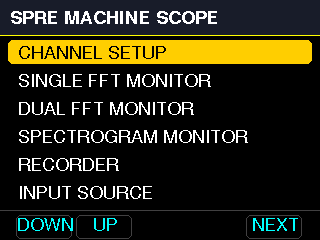

| 設定                 | 選択肢                                       | 備考                                          |
| ------------------ | ----------------------------------------- | ------------------------------------------- |
| SAMPLING RATE      | 16 kHz / 48 kHz / 192 kHz                 | サンプリングレートの設定                                |
| AVAILABLE CHANNELS | 1 / 2 / 3 / 4 チャンネル                       | 有効にするマイク入力の数。192 kHz では 1 / 2 チャンネルだけが表示される |
| FFT WINDOW         | RECTANGULAR / HAMMING / HANNING / FLATTOP | FFT の窓関数                                    |

<br/>

#### 4-1-2. SAMPLING RATE（サンプリングレート選択画面）

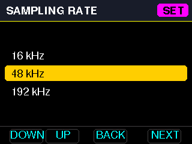

<br/>

#### 4-1-3. AVAILABLE CHANNELS（チャンネル選択画面）

有効にするマイク入力数。サンプリングレートを 192kHz にした場合はハードウェアの制約で 2 チャンネルまでしか選択できない。

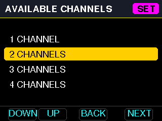

<br/>

### 4-2. 信号解析の共通の設定画面
| 設定                | 選択肢                                                                        | 備考                                            |
| ----------------- | -------------------------------------------------------------------------- | --------------------------------------------- |
| FFT LINE SETTING  | 100 / 200 / 400 / 800 / 1600 ライン                                           | それぞれ 256 / 512 / 1024 / 2048 / 4096 サンプルで FFT |
| LOW PASS FILTER   | 0 / 1k / 2k / 5k / 10k / 15k / 20k Hz                                      | 0 はフィルタなし                                     |
| HIGH PASS FILTER  | 0 / 5 / 10 / 15 / 20 / 100 / 200 / 500 / 1k / 2k / 5k / 10k / 15k / 20k Hz | 0 はフィルタなし                                     |
| FFT RANGE SETTING | 2 k 〜 75 kHz                                                               | グラフに表示する最大周波数                                 |

フィルタは CH1 と CH2 の両方に、同じ設定でかかります。フィルタは 2 次の IIR（Q = 0.5）で、設定した周波数での減衰は −6 dB、その先は 12 dB/oct で減衰します。サンプリングレートの半分以上の周波数は選択肢に表示されません（16 kHz では LPF / HPF とも 5k Hz まで）。

<br/>

### 4-3. SINGLE FFT MONITOR（1 チャンネルの解析）

#### 4-3-1. ホーム画面

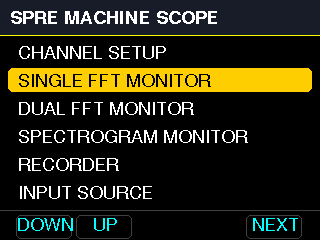

<br/>


#### 4-3-2. チャンネル選択画面

信号解析をするチャンネルを選択します。INPUT SOURCE に MIC を選択している場合は、マイク入力チャンネル。 FILE もしくは FILE + SOUND を選択している場合は録音しているデータのチャンネルを選択します。

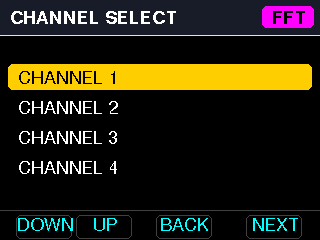

<br/>

#### 4-3-3. 解析ライン数選択画面

解析するライン数を選択します。ラインとは振動解析でよく使われる用語で 100 LINES は 1 フレーム 256サンプルを表します。したがって、400 LINES の場合は、1 フレーム 1024 サンプル。1600 LINES の場合は、4096 サンプルにあたります。

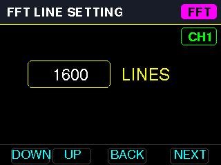

<br/>

#### 4-3-4. ローパスフィルタ設定画面

適用するローパスフィルタのカットオフ周波数を設定する画面です。ローパスフィルタには 2 次の双二次型の IIR フィルタ (Q=0.5) を使っています。設定した周波数では -6 dB 減衰します。FIRフィルタに比べなだらかな特性でやや波形歪も発生しますが、高速に処理ができるのが特徴です。

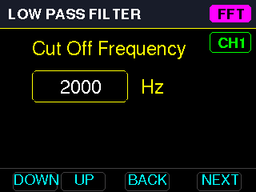

<br/>

#### 4-3-5. ハイパスフィルタ設定画面

適用するハイパスフィルタのカットオフ周波数を設定する画面です。ハイパスフィルタも 2 次の双二次型の IIR フィルタ (Q=0.5) を使っています。設定した周波数では -6 dB 減衰します。FIRフィルタに比べなだらかな特性でやや波形歪も発生しますが、高速に処理ができるのが特徴です。

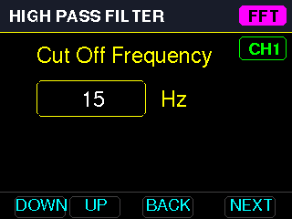

<br/>

#### 4-3-6. デジタルフィルタ効果確認画面

デジタルフィルタ効果を確認する画面です。上の波形がオリジナルの信号波形。下の波形がフィルタ後の波形です。ここで INPUT SOURCE を FILE + SOUND に選択しているとフィルタをかけたあとの音がスピーカー出力から聞くことができます。

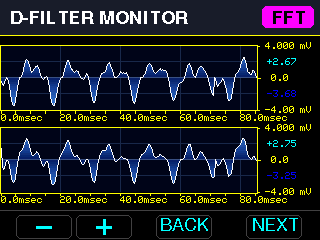

<br/>

#### 4-3-7. FFT出力レンジ設定画面

FFT出力レンジを設定画面です。最大の出力周波数を設定します。ここで、例えば「5000 Hz」に設定すると、FFTの出力が 5000 Hz までになります。低周波数のスペクトルの様子を拡大してみたいときに使うことができます。

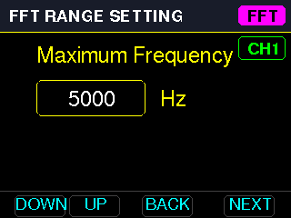

<br/>

#### 4-3-8. FFTグラフ選択画面

FFTスペクトラムグラフを選択する画面です。

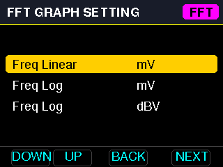

それぞれ次節で示すグラフになります。

<br/>

#### 4-3-9. FFT REALTIME MONITOR 画面

INPUT SOURCE が MIC もしくは FILE を選択している場合は、信号波形とスペクトルのみの出力になります。FILE + SOUND を選択している場合は、フィルタが適用された信号がスピーカーから出力されます。

<br/>

##### Freq Linear - mV : 周波数軸リニア、振幅 mV
上段に波形、下段にスペクトルを表示します。(−)/(+) で表示倍率を変えます。FFTスペクトルグラフの横軸（周波数）はリニア表示になります。

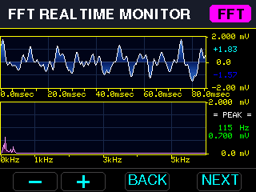

<br/>

##### Freq Log - mV: 周波数軸対数、振幅 mV
上段に波形、下段にスペクトルを表示します。(−)/(+) で表示倍率を変えます。FFTスペクトルグラフの横軸（周波数）は対数表示になります。

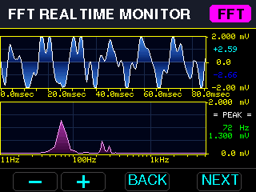

<br/>

##### Freq Log - dBV: 周波数軸対数、振幅 dBV
上段に波形、下段にスペクトルを表示します。(−)/(+) で表示倍率を変えます。dBV 表示では、グラフ上端が波形のフルスケールに合わせて 10 dB 単位で動き、下端は上端の 100 dB 下になります。

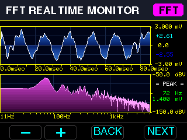

<br/>

### 4-4. DUAL FFT MONITOR（2 チャンネルの比較）

このグラフは２つの信号を比較するときに画面になります。２つの信号の相関を見るリサージュ・グラフ（オービット）を確認することもできます。

<br/>

#### 4-4-1. ホーム画面

<br/>

#### 4-4-2. チャンネル選択画面

B0 で CH1 に使う入力、B1 で CH2 に使う入力を切り替えます。

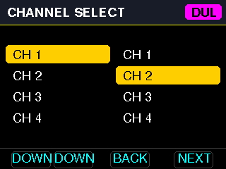

<br/>

#### 4-4-3. FFT ・フィルタ設定画面

FFTの各種パラメータを設定します。ここは「**SINGLE FFT MONITOR**」の設定と同じですので省略します。
<br/>

#### 4-4-4. ２つの信号の比較画面（**DUAL SIGNAL MONITOR**）

 上段に CH1（青）、下段に CH2（緑）の波形を表示します。この２つの信号はローパス・ハイパスフィルタを適用した後の信号です。このとき FILE + SOUND を選択しているとフィルタ適用後の信号がスピーカーから出力されます。

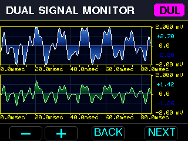

<br/>

#### 4-4-5. グラフ選択画面

FFT出力レンジを設定したら、出力するグラフを選択する画面が出てきます。

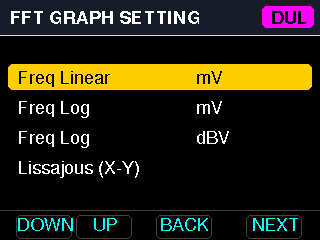

<br/>

##### Freq Linear - mV: 周波数軸リニア、振幅 mV
 上段に CH1 と CH2 のスペクトルを重ねて表示し、下段に差分（CH1 − CH2、赤）を表示します。
(−)/(+) で表示倍率を変えることができます。

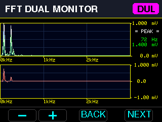

<br/>

##### Freq Log - mV : 周波数軸対数、振幅 mV
 上段に CH1 と CH2 のスペクトルを重ねて表示し、下段に差分（CH1 − CH2、赤）を表示します。
(−)/(+) で表示倍率を変えることができます。

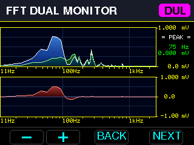

<br/>

##### Freq Log - dBV: 周波数軸対数、振幅 dBV
 上段に CH1 と CH2 のスペクトルを重ねて表示し、下段に差分（CH1 − CH2、赤）を表示します。dBV 表示では、(−)/(+) で表示範囲を 5 dB ずつ上下に動かします。
 
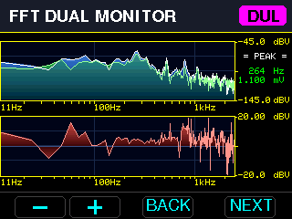

<br/>

##### **Lissajous (X-Y): リサージュ図形**
   横軸を CH1、縦軸を CH2 としてリサージュ図形を描きます。古い軌跡は残光として徐々に暗くなります。(−)/(+) で表示倍率を変え、右側にフルスケール（例: +/-25.0 mV）を表示します。同じ信号なら斜めの直線、位相がずれると楕円になります。

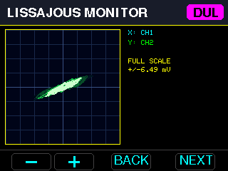

<br/>

### 4-5. SPECTROGRAM MONITOR（時間変化の表示）

チャンネル・ライン数・フィルタ・表示範囲を設定したあと、スペクトルの時間変化を色の濃淡で表示します。(−)/(+) で色の感度を変えます。

<br/>

#### 4-5-1. ホーム画面

<br/>

#### 4-5-2. チャンネル選択・ライン選択・フィルタ設定・FFTレンジ設定

これらの設定は、「**SINGLE FFT MONITOR**」の設定と同じですので省略します。

<br/>

#### 4-5-3. スペクトログラム表示

スペクトルの時間変化を色の濃淡で表示します。時間経過で音や振動が変化するものを観察するときに視覚で変化を確認できます。(−)/(+) で色の感度を変えます。

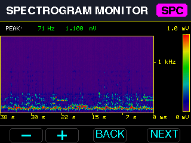

<br/>

### 4-6. RECORDER（WAV 録音）

音や振動を録音することができます。16 ビットで録音します。

<br/>

#### 4-6-1. ホーム画面

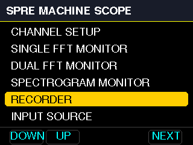

<br/>

#### 4-6-2. 録音チャンネル数設定

1 チャンネルまたは 2 チャンネルを選びます。ただし、サンプリングレートが 192 kHz の場合はハードウェアの制約 (SDカードの記録速度) により 1チャンネルしか選択できません。

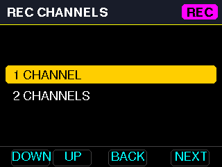

<br/>

#### 4-6-3. 録音チャンネル設定

録音チャンネルを選択します。 2 チャンネルを選びます。入力を 4 チャンネルに設定している場合は、CH 1 〜 4 の間からそれぞれ選択することができます。

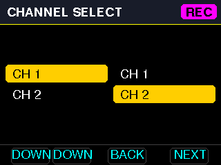

<br/>

#### 4-6-4. 録音モニター

 B0（REC）で録音の開始・停止、B1（AMP）で波形の表示倍率を 1 → 2 → 5 → … → 500 の順に切り替えます。録音は SD カードの `RECDATA` フォルダに `RECnnnnn.WAV` として保存されます。

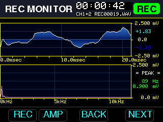

録音の制限:
- 入力ソースが FILE のときは録音できません。その場合、「SET SRC TO MIC」と表示されます。ホームメニューの INPUT SOURCE で MIC に戻してください。
- 書き込み速度の制限により、192 kHz では 1 チャンネルのみです。「RATE TOO HIGH」と表されます。
- 書き込みが間に合わない場合、時間表示のところに「!」が出ますので、その場合は録音を停止し、やり直してください。
- 録音中は FFT のライン数が 400 ライン（1024 サンプル）までに制限されます。
- 録音中は、画面キャプチャすることができません。

<br/>


### 4-7. INPUT SOURCE（入力の切り替え）
| 選択肢          | 動作                                                                                                                                                                                                 |
| ------------ | -------------------------------------------------------------------------------------------------------------------------------------------------------------------------------------------------- |
| MIC          | マイク入力を解析します（通常の動作）                                                                                                                                                                                 |
| FILE         | SD カードの `RECDATA/RECnnnnn.WAV` を入力として解析します。PLAYBACK FILE 画面で、最大 5 件のファイル（レート・チャンネル数・長さを表示）から選びます                                                                                                   |
| FILE + SOUND | FILE と同様に解析しながら、ヘッドホン端子から音を再生します。PLAYBACK VOLUME 画面で音量（+12 〜 −60 dB、初期値 −30 dB）を選んでから、ファイルを選びます。0 dB より上は小さな振動音を聞くためのもので、大きな信号では音が割れたり大きすぎたりするので、ヘッドホンを耳から離して確かめてから上げてください。再生音にも LPF / HPF が適用されます |

<br/>


#### 4-7-1. ホーム画面

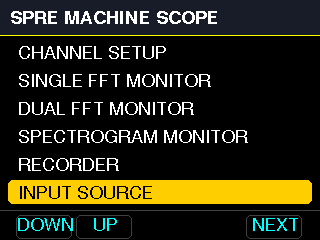

<br/>


#### 4-7-2. 入力選択画面

MIC (マイク入力)、FILE (信号解析のみ)、FILE + SOUND (信号解析とスピーカー出力) から選択できます。 FILE + SOUND の場合は、信号解析をしながらスピーカー出力でヘッドホンなどを使って録音した信号を確認しながら信号の状態を確認できます。

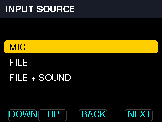

<br/>


#### 4-7-3. プレイバックファイル選択画面

録音したファイルを選択する画面です。ファイル名、サンプリングレート、チャンネ数、録音時間を表示します。

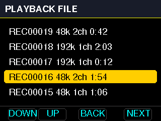

<br/>


#### 4-7-4. 再生音のボリューム設定画面

再生ファイルをスピーカーで出力する際のボリュームを設定できます。12 dB 〜 - 60 dB まで設定でき、小さい値ほど音が小さくなります。

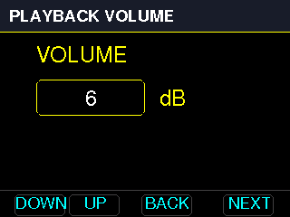

<br/><br/>
<hr/>

## 5. SD カードに作られるファイル
| ファイル | 内容 |
|---|---|
| `config/sys.txt`, `config/AAnnn.txt` | 設定ファイル・画面定義 |
| `RECDATA/RECnnnnn.WAV` | RECORDER で録音した WAV ファイル（FILE 入力の再生対象もこのフォルダ） |
| `CSVDATA/*.csv` | (−) と (+) の同時押し、またはキャプチャで保存した測定データ（2-2） |
| `CAPIMAGE/SCRnnnnn.BMP` | BACK と NEXT の同時押しで保存した画面キャプチャ（2-3） |

フォルダは起動時に自動で作られます。以前のバージョンでルートに保存されたファイルも、起動時にそれぞれのフォルダへ移動します（フォルダに同名のファイルがあるときは移動せずルートに残します）。

<br/><br/>
<hr/>

## 6. エラー表示（LED）
エラーが起きると、メインボードの LED が点滅します。

| LED | 意味 | 主な対処 |
|---|---|---|
| LED0 | ファイルエラー（SD カードがない、設定ファイルがない） | SD カードを挿す。`Documents/config` のファイルを `config` フォルダにコピーし直す |
| LED1 | 設定ファイルが壊れている | 表示されたファイルを `Documents/config` のものと置き換える |
| LED2 | コア間通信のエラー | リセットする。続く場合は両コアを書き込み直す |
| LED3 | メモリ不足 | ライン数やチャンネル数を減らす |

シリアルモニタ（115200 bps）に、エラーの原因となったファイル名などが表示されます。

<br/><br/>
<br/><br/>


---

# User Manual

**SpreMachineScope** shows the signals of the Spresense microphone inputs (up to 4 channels) on the LCD as waveforms, spectra, spectrograms and Lissajous figures. It can also record WAV files to the SD card, analyze the recorded files, capture the screen and save the measured data as CSV files.


An attachment to connect vibration sensors can be used. Piezo sensors can also be connected. Please contact us for details.


## 1. Preparation

### 1-1. What you need
- Spresense main board + extension board
- ILI9341 LCD (320×240) and 4 buttons (D7 / D6 / D5 / D4)
- Microphones or sensors (the voltage range of the microphone input is ±0.45 V)
- microSD card (for the setting files, recordings, CSV files and captures)
- Headphones (to listen to the playback with FILE + SOUND)

### 1-2. Easy install (Releases)
You can install it with a zip of [Releases](https://github.com/TE-YoshinoriOota/Spresense_fftanalyzer_sample/releases) without building it in the Arduino IDE.

1. Download and extract `SpreMachineScope-<version>-windows.zip` for Windows, or `SpreMachineScope-<version>-linux.zip` for Linux.
2. Connect Spresense with USB, and insert the SD card into your PC.
3. Run `install.bat` on Windows or `install.sh` on Linux, and enter the serial port and the SD card. It writes the firmware and copies the setting files to the SD card.

Only for the first time, the bootloader v3.4.3 must be written ("Burn Bootloader" of the Arduino IDE). See `README.txt` in the zip for the USB driver, the DSP (SRC) and other details.

### 1-3. Installation from the source
1. **Install the DSP codec**: in the Arduino IDE, open "Examples" > "Audio" > "dsp_installer" > "src_installer", flash it, and select the SD card on the serial monitor to install the codec.
2. **Libraries**: put [ArduinoJson (the author's fork)](https://github.com/TE-YoshinoriOota/ArduinoJson), and [Adafruit_ILI9341](https://github.com/kzhioki/Adafruit_ILI9341) and [Adafruit-GFX-Library](https://github.com/kzhioki/Adafruit-GFX-Library) optimized for Spresense (the `spresense` branch of both), in the Arduino libraries folder.
3. **Copy the setting files**: copy `Documents/config` to the SD card as a whole. It holds the files of the system settings and the settings of the screens.
4. **Flash Subcore1**: open `Subcore1/Subcore1.ino`, set "Core" to **SubCore 1** and upload.
5. **Flash Maincore**: open `Maincore/Maincore.ino`, set "Core" to **MainCore** and "Memory" to **896 kB**, and upload. With the default (768 kB), it does not run because of a lack of memory.

## 2. Basic operation

### 2-1. Buttons
The 4 labels at the bottom of the screen show what each button does at the moment.


| Button | Pin | Menu and setting screens | Graph screens |
|---|---|---|---|
| B0 (left) | D7 | DOWN: move the cursor down / decrease the value | (−): decrease the magnification (AMP) |
| B1 | D6 | UP: move the cursor up / increase the value | (+): increase the magnification (AMP) |
| B2 | D5 | BACK: go back to the previous screen | BACK: go back to the previous screen |
| B3 (right) | D4 | NEXT: select and go to the next screen | NEXT: go to the next screen |

Pressing two buttons together has the following functions.

| Buttons | Screens | Function |
|---|---|---|
| (−) and (+) | Graph screens (except REC MONITOR) | Save the data on the screen as CSV (2-2) |
| BACK and NEXT | All screens | Screen capture (2-3) |

When two buttons are pressed together, the function of each button alone (changing the magnification, moving between screens) does not work.

### 2-2. Saving the data (CSV)
Press (−) and (+) together on a graph screen to save the data on the screen to a CSV file in the `CSVDATA` folder of the SD card.

- **When the file is created**: a CSV file is created the first time you save on a screen. When you save again on the same screen, one more row is added to the same file. After you move to another screen, saving creates a new file. No file is created on a screen where you do not save.
- **Confirmation**: after saving, the file name and the number of saves on the screen, such as `SAVED wf01003.csv #2`, are shown at the top right of the graph for 3 seconds (on the right side of the graph on LISSAJOUS MONITOR). If the data could not be saved, `SAVE ERROR` is shown in red.
- **When the data is not saved**: while recording, and on the REC MONITOR screen.

The file name is "type + 2-digit day + 3-digit number" (e.g. `wf01003.csv`). The day is the day of the Spresense clock, which is `01` when the clock is not set. If a file of the same name already exists, its number is skipped and the next free number is used, so earlier files are never overwritten.

Each save writes one row to one or two of the following files, depending on the screen.

| Screen | File 1 | File 2 |
|---|---|---|
| FFT REALTIME MONITOR, SPECTROGRAM MONITOR | `wf`: waveform | `ft`: spectrum |
| D-FILTER MONITOR | `wi`: waveform before the filter | `wo`: waveform after the filter |
| DUAL SIGNAL MONITOR, LISSAJOUS MONITOR | `wa`: CH1 waveform | `wb`: CH2 waveform |
| FFT DUAL MONITOR | `fa`: CH1 spectrum | `fb`: CH2 spectrum |

The first value of each row is the sampling interval dt [ms] for a waveform, or the frequency interval df [Hz] for a spectrum. The data values follow, separated by commas.

### 2-3. Screen capture
Press BACK and NEXT together to save the screen to the `CAPIMAGE` folder of the SD card as `SCRnnnnn.BMP` (320×240, 16-bit color). On a graph screen, the data at the moment of the capture is also saved as one row in the same CSV files as 2-2 (`SAVED` is not shown in this case). The screen cannot be captured while recording.

### 2-4. Saved settings
The values selected on each screen (channels, lines, filters, AMP and so on) are written to `config/sys.txt` and to the file of each screen on the SD card, and are restored at the next startup. The files are written through a temporary file, so they are unlikely to be broken even if the power is turned off while writing.

## 3. Menu structure

At startup, the home menu "SPRE MACHINE SCOPE" is shown.

```
SPRE MACHINE SCOPE
├─ CHANNEL SETUP
│    └─ Sampling rate
│        └─ Input channels
│            └─ FFT window
├─ SINGLE FFT MONITOR
│    └─ Channel
│        └─ Lines
│            └─ LPF
│                └─ HPF
│                    └─ D-FILTER MONITOR
│                        └─ FFT range
│                            └─ Graph type
│                                └─ FFT REALTIME MONITOR
├─ DUAL FFT MONITOR
│    └─ Channels
│        └─ Lines
│            └─ LPF
│                └─ HPF
│                    └─ DUAL SIGNAL MONITOR
│                        └─ FFT range
│                            └─ Graph type
│                                └─ FFT DUAL MONITOR / LISSAJOUS MONITOR
├─ SPECTROGRAM MONITOR
│    └─ Channel
│        └─ Lines
│            └─ LPF
│                └─ HPF
│                    └─ D-FILTER MONITOR
│                        └─ FFT range
│                            └─ SPECTROGRAM MONITOR
├─ RECORDER
│    └─ Recording channels
│        └─ Channel
│            └─ REC MONITOR (start / stop recording)
└─ INPUT SOURCE
     ├─ MIC (microphone input)
     ├─ FILE (analysis of a recording only)
     │   └─ Playback file
     └─ FILE + SOUND (analysis and playback of a recording)
         └─ Playback volume
             └─ Playback file
```

Press NEXT to go to the next screen. NEXT on the last monitor screen returns to the home menu.

## 4. How to use each function

### 4-1. CHANNEL SETUP (basic input settings)

#### 4-1-1. Home screen


| Setting | Choices | Note |
|---|---|---|
| SAMPLING RATE | 16 kHz / 48 kHz / 192 kHz | Sampling rate |
| AVAILABLE CHANNELS | 1 / 2 / 3 / 4 channels | Number of microphone inputs to use. Only 1 / 2 channels are shown at 192 kHz |
| FFT WINDOW | RECTANGULAR / HAMMING / HANNING / FLATTOP | Window function of the FFT |

#### 4-1-2. SAMPLING RATE (sampling rate screen)


#### 4-1-3. AVAILABLE CHANNELS (channel screen)

The number of microphone inputs to use. At a sampling rate of 192 kHz, only up to 2 channels can be selected because of a hardware limit.


### 4-2. Common setting screens of the signal analysis
| Setting | Choices | Note |
|---|---|---|
| FFT LINE SETTING | 100 / 200 / 400 / 800 / 1600 lines | FFT of 256 / 512 / 1024 / 2048 / 4096 samples |
| LOW PASS FILTER | 0 / 1k / 2k / 5k / 10k / 15k / 20k Hz | 0: no filter |
| HIGH PASS FILTER | 0 / 5 / 10 / 15 / 20 / 100 / 200 / 500 / 1k / 2k / 5k / 10k / 15k / 20k Hz | 0: no filter |
| FFT RANGE SETTING | 2 k to 75 kHz | Maximum frequency shown on the graph |

The filters are applied to both CH1 and CH2 with the same settings. They are 2nd-order IIR filters (Q = 0.5): −6 dB at the cutoff frequency and 12 dB/oct beyond it. Cutoffs of half the sampling rate or more are not shown (up to 5k Hz for both LPF and HPF at 16 kHz).

### 4-3. SINGLE FFT MONITOR (analysis of one channel)

#### 4-3-1. Home screen


#### 4-3-2. Channel screen

Select the channel to analyze. When MIC is selected in INPUT SOURCE, it is a microphone input channel. When FILE or FILE + SOUND is selected, it is a channel of the recorded data.


#### 4-3-3. Lines screen

Select the number of lines to analyze. "Lines" is a term often used in vibration analysis: 100 LINES means a frame of 256 samples. So 400 LINES is a frame of 1024 samples, and 1600 LINES is 4096 samples.


#### 4-3-4. Low pass filter screen

Set the cutoff frequency of the low pass filter. The low pass filter is a 2nd-order biquad IIR filter (Q = 0.5). The attenuation at the set frequency is −6 dB. Compared with an FIR filter, its slope is gentler and it distorts the waveform a little, but it can be processed fast.


#### 4-3-5. High pass filter screen

Set the cutoff frequency of the high pass filter. The high pass filter is also a 2nd-order biquad IIR filter (Q = 0.5). The attenuation at the set frequency is −6 dB. Compared with an FIR filter, its slope is gentler and it distorts the waveform a little, but it can be processed fast.


#### 4-3-6. Digital filter check screen

Check the effect of the digital filters. The upper waveform is the original signal, and the lower one is the signal after the filters. When FILE + SOUND is selected in INPUT SOURCE, you can hear the filtered sound from the audio output.


#### 4-3-7. FFT range screen

Set the range of the FFT output, that is, the maximum frequency of the output. For example, with "5000 Hz", the FFT output goes up to 5000 Hz. Use it to zoom in on the spectrum at low frequencies.


#### 4-3-8. FFT graph screen

Select the graph of the FFT spectrum.


Each choice gives the graph shown in the next section.

#### 4-3-9. FFT REALTIME MONITOR screen

When MIC or FILE is selected in INPUT SOURCE, only the waveform and the spectrum are shown. When FILE + SOUND is selected, the filtered signal is also played on the audio output.

##### Freq Linear - mV: linear frequency axis, amplitude in mV
Shows the waveform in the upper graph and the spectrum in the lower graph. (−)/(+) change the magnification. The horizontal axis (frequency) of the spectrum is linear.


##### Freq Log - mV: logarithmic frequency axis, amplitude in mV
Shows the waveform in the upper graph and the spectrum in the lower graph. (−)/(+) change the magnification. The horizontal axis (frequency) of the spectrum is logarithmic.


##### Freq Log - dBV: logarithmic frequency axis, amplitude in dBV
Shows the waveform in the upper graph and the spectrum in the lower graph. (−)/(+) change the magnification. In dBV, the top of the graph follows the full scale of the waveform in steps of 10 dB, and the bottom is 100 dB below the top.


### 4-4. DUAL FFT MONITOR (comparison of two channels)

Use these screens to compare two signals. You can also see a Lissajous graph (orbit) that shows the correlation of the two signals.

#### 4-4-1. Home screen


#### 4-4-2. Channel screen

B0 selects the input for CH1, and B1 the input for CH2.


#### 4-4-3. FFT and filter screens

Set the parameters of the FFT. They are the same as the settings of **SINGLE FFT MONITOR**, so they are omitted here.

#### 4-4-4. Comparison of two signals (**DUAL SIGNAL MONITOR**)

Shows CH1 (blue) in the upper graph and CH2 (green) in the lower graph. Both are the signals after the low pass and high pass filters. When FILE + SOUND is selected, the filtered signals are played on the audio output.


#### 4-4-5. Graph screen

After setting the FFT range, the screen to select the graph appears.


##### Freq Linear - mV: linear frequency axis, amplitude in mV
Shows the spectra of CH1 and CH2 overlaid in the upper graph, and the difference (CH1 − CH2, red) in the lower graph.
(−)/(+) change the magnification.


##### Freq Log - mV: logarithmic frequency axis, amplitude in mV
Shows the spectra of CH1 and CH2 overlaid in the upper graph, and the difference (CH1 − CH2, red) in the lower graph.
(−)/(+) change the magnification.


##### Freq Log - dBV: logarithmic frequency axis, amplitude in dBV
Shows the spectra of CH1 and CH2 overlaid in the upper graph, and the difference (CH1 − CH2, red) in the lower graph. In dBV, (−)/(+) move the range up and down by 5 dB.


##### **Lissajous (X-Y): Lissajous figure**
Draws a Lissajous figure with CH1 on the horizontal axis and CH2 on the vertical axis. Older traces fade out gradually like an afterglow. (−)/(+) change the magnification, and the full scale (e.g. +/-25.0 mV) is shown on the right. The same signal gives a diagonal line, and a phase difference gives an ellipse.


### 4-5. SPECTROGRAM MONITOR (changes over time)

After setting the channel, lines, filters and range, the spectrum over time is shown in shades of color. (−)/(+) change the color sensitivity.

#### 4-5-1. Home screen


#### 4-5-2. Channel, lines, filters and FFT range

These settings are the same as those of **SINGLE FFT MONITOR**, so they are omitted here.

#### 4-5-3. Spectrogram

Shows the spectrum over time in shades of color. You can see the changes of sound or vibration over time. (−)/(+) change the color sensitivity.


### 4-6. RECORDER (WAV recording)

Records sound or vibration in 16 bits.

#### 4-6-1. Home screen


#### 4-6-2. Recording channels

Select 1 or 2 channels. At a sampling rate of 192 kHz, only 1 channel can be selected because of a hardware limit (the writing speed of the SD card).


#### 4-6-3. Recording channel selection

Select the channels to record, two channels. When the input is set to 4 channels, each can be selected from CH 1 to 4.


#### 4-6-4. Recording monitor

B0 (REC) starts and stops the recording, and B1 (AMP) changes the magnification of the waveform in the order 1 → 2 → 5 → … → 500. The recording is saved in the `RECDATA` folder of the SD card as `RECnnnnn.WAV`.


Limits of the recording:
- No recording when the input source is FILE. "SET SRC TO MIC" is shown: select MIC in INPUT SOURCE of the home menu.
- Only 1 channel at 192 kHz because of the writing speed. "RATE TOO HIGH" is shown.
- If the writing cannot keep up, "!" appears after the time. In that case, stop the recording and record again.
- While recording, the FFT is limited to 400 lines (1024 samples).

### 4-7. INPUT SOURCE (switching the input)
| Choice | Behavior |
|---|---|
| MIC | Analyzes the microphone inputs (normal operation) |
| FILE | Analyzes `RECDATA/RECnnnnn.WAV` on the SD card as the input. On the PLAYBACK FILE screen, select one of up to 5 files (rate, channels and length are shown) |
| FILE + SOUND | Analyzes the file like FILE and plays it on the headphone jack. Select the volume (+12 to −60 dB, −30 dB by default) on the PLAYBACK VOLUME screen, then select the file. The volume above 0 dB is for hearing small vibrations: a large signal may be distorted or too loud, so check it with the headphones away from your ears before turning it up. LPF / HPF are also applied to the sound |

#### 4-7-1. Home screen


#### 4-7-2. Input screen

Select MIC (microphone input), FILE (signal analysis only) or FILE + SOUND (signal analysis and audio output). With FILE + SOUND, you can check the state of the signal by listening to the recorded signal with headphones while it is analyzed.


#### 4-7-3. Playback file screen

Select the recorded file. The file name, sampling rate, number of channels and recording time are shown.


#### 4-7-4. Playback volume screen

Set the volume of the playback on the audio output, from 12 dB to −60 dB. The smaller the value, the quieter the sound.


## 5. Files on the SD card
| File | Contents |
|---|---|
| `config/sys.txt`, `config/AAnnn.txt` | Setting files and screen definitions |
| `RECDATA/RECnnnnn.WAV` | WAV files recorded with RECORDER (FILE input also plays the files in this folder) |
| `CSVDATA/*.csv` | Data saved with (−) and (+) together, or with a capture (2-2) |
| `CAPIMAGE/SCRnnnnn.BMP` | Screen captures saved with BACK and NEXT together (2-3) |

The folders are created automatically at startup. Files saved on the root by earlier versions are also moved to their folders at startup (a file is left on the root if the folder already has a file of the same name).

## 6. Error indication (LED)
When an error occurs, an LED on the main board blinks.

| LED | Meaning | What to do |
|---|---|---|
| LED0 | File error (no SD card, or a setting file is missing) | Insert the SD card. Copy the files in `Documents/config` to the `config` folder again |
| LED1 | A setting file is broken | Replace the file shown on the serial monitor with the one in `Documents/config` |
| LED2 | Communication error between the cores | Reset. If it continues, flash both cores again |
| LED3 | Out of memory | Reduce the lines or the channels |

The serial monitor (115200 bps) shows the cause of the error, such as the file name.


